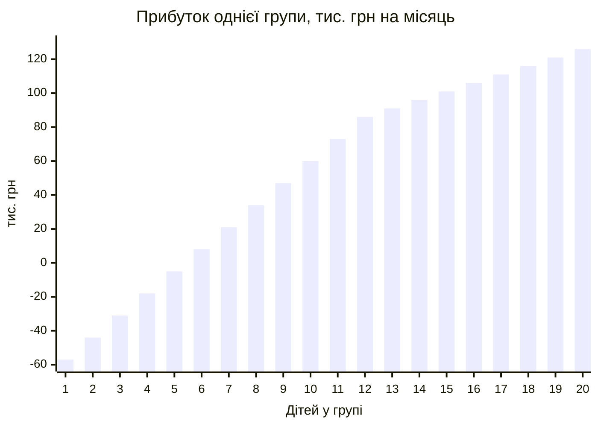
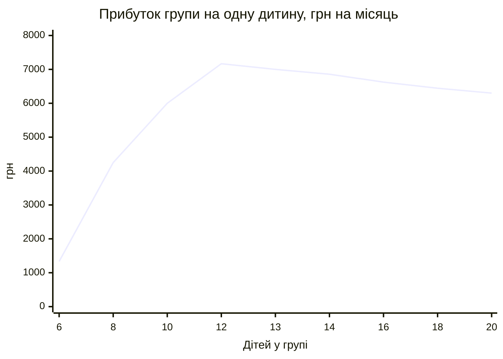
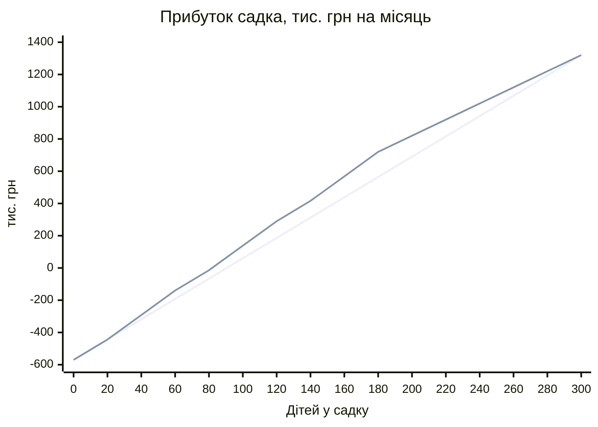

# Розмір групи і прибуток садка

Чому садку вигідніше спершу відкривати групи по 12–13 дітей, а групи по 20 заповнювати лише тоді, коли груп уже максимум. Усі числа пораховані тими самими функціями, що й прогноз системи ([finance-formulas.js](../../src/services/finance-formulas.js)), за налаштуваннями за замовчуванням. Суми — гривні на місяць.

## Коротко

- **Група окупає себе з 6 дітей.** Перші 12 дітей групи приносять по +13 000 кожна, а з 13-ї по 20-ту — лише по +5 000: за кожну дитину понад 12 садок доплачує вихователю й помічнику 8 000.
- **Найбільший прибуток на одну дитину — у групі з 12 дітей**, а не з 20.
- **Коли дітей стільки, скільки є, вигідніше відкрити ще одну групу, ніж додавати 13-ту дитину в наявні.** Кожна додаткова група з 12+ дітьми дає +26 000 на місяць.
- **Звідси дві фази набору:**
    1. до 180 дітей (15 груп × 12) — відкривати групи по 12–13;
    2. після 180 — груп більше не можна (BR-19), тож заповнювати наявні до 20.
- **З таким розподілом садок виходить у плюс з 82 дітей**, а не з 89 (найменше груп) чи 91 (заповнення по черзі до 20), і заробляє до +156 000 на місяць більше.
- **Як заповнювати, важить навіть за тієї самої кількості груп:** 90 дітей у 5 групах по 18 дають +10 000, а 20/20/20/20/10 — −6 000. Рівномірно завжди вигідніше, ніж «забити до 20, а решту окремо».
- **Висновок залежить від налаштувань:** він тримається, поки оренда кімнати менша за 76 000. Прогноз системи рахує це сам щоразу з поточних налаштувань.

## 1. Вихідні дані

| Позначення | Що                                         | Значення |
| ---------- | ------------------------------------------ | -------: |
| $t$        | навчання на місяць за дитину               |   15 000 |
| $e$        | вихователю за кожну дитину                 |    2 000 |
| $b_e$      | вихователю за кожну дитину понад поріг     |    5 000 |
| $b_a$      | помічнику за кожну дитину понад поріг      |    3 000 |
| $A$        | базова ставка помічника                    |   20 000 |
| $R$        | оренда кімнати групи                       |   50 000 |
| $T$        | поріг дітей, після якого йдуть доплати     |       12 |
| $S$        | спільні витрати садка (не належать групам) |  570 000 |

Позначимо доплату за дитину понад поріг $b = b_e + b_a = 8\,000$, а постійні витрати групи $R + A = 70\,000$.

Спільні витрати $S$ — оцінка BA: 1 менеджер (80 000), 6 викладачів (6 × 40 000) і 5 кімнат для занять (5 × 50 000). Харчування в розрахунок не входить: батьки платять за нього стільки, скільки воно коштує садку, тож його чистий вплив нульовий (BR-33).

## 2. Прибуток однієї групи

Група з $n$ дітей:

$$
P(n) = t \cdot n \;-\; e \cdot n \;-\; (R + A) \;-\; b \cdot \max(0,\ n - T)
$$

Розкривши максимум:

$$
P(n) =
\begin{cases}
(t - e)\,n - (R + A) = 13\,000\,n - 70\,000, & n \le 12 \\[4pt]
(t - e - b)\,n + (b\,T - R - A) = 5\,000\,n + 26\,000, & n > 12
\end{cases}
$$

Звідси:

- **Кожна дитина до 12-ї** додає $t - e = 13\,000$, **кожна після** — лише $t - e - b = 5\,000$.
- **Група окупає себе**, коли $13\,000\,n > 70\,000$, тобто з **6 дітей**.



До 12 дітей стовпчики ростуть на 13 000 за дитину, після 12 — на 5 000.

## 3. Прибуток на одну дитину

Якщо поділити прибуток групи на кількість дітей, видно, де кожна дитина «працює» найкраще:



Пік — **12 дітей (7 167 на дитину)**. У групі з 20 дітей — 6 300.

## 4. Скільки груп, коли дітей стільки, скільки є

Нехай $N$ дітей розподілено на $g$ груп, і в кожній щонайменше $T$ дітей. Підсумуємо $P(n)$ по групах, $\sum n = N$:

$$
\Pi(N, g) = (t - e - b)\,N \;+\; (b\,T - R - A)\,g \;-\; S
$$

Множник при $g$:

$$
b\,T - (R + A) = 8\,000 \cdot 12 - 70\,000 = +26\,000
$$

Він додатний, тож **кожна додаткова група, у якій лишається щонайменше 12 дітей, дає +26 000 на місяць.** Причина: нова група коштує $R + A = 70\,000$, але 12 дітей у ній перестають бути «понад поріг», і садок економить $12 \cdot 8\,000 = 96\,000$ на доплатах.

Якщо ж у групах менше $T$ дітей:

$$
\Pi(N, g) = (t - e)\,N - (R + A)\,g - S
$$

Тут кожна зайва група лише забирає 70 000, тож **ділити групи нижче 12 дітей невигідно.** Отже, оптимум — групи якраз на порозі, по 12–13 дітей.

Приклад: 180 дітей, той самий садок, різний максимум групи:

| Максимум дітей у групі | Груп | Прибуток садка |
| ---------------------: | ---: | -------------: |
|                     20 |    9 |        564 000 |
|                     18 |   10 |        590 000 |
|                     16 |   12 |        642 000 |
|                     14 |   13 |        668 000 |
|                     13 |   14 |        694 000 |
|                     12 |   15 |    **720 000** |

Ті самі діти, а прибуток на 156 000 (28%) більший.

Пільги й річна оплата змінюють лише $t$, а $t$ у множник при $g$ не входить. Тож висновок не залежить від пільг: при мінімальному чеку 9 240 (пільга 30% і річна оплата) кожна додаткова група так само дає +26 000.

## 5. Дві фази набору

Груп не може бути більше 15 (BR-19). Тому:

1. **До $15 \cdot 12 = 180$ дітей** — розподіляти по 12–13 дітей у групу, кількість груп $g \approx N / 12$.
2. **Після 180 дітей** — нових груп відкрити не можна, тож заповнювати наявні 15 груп, аж до 20 дітей ($15 \cdot 20 = 300$, максимум садка).

### Три способи розсадити тих самих дітей

| Спосіб             | Як                                                       | 90 дітей                  | 150 дітей                  |
| ------------------ | -------------------------------------------------------- | ------------------------- | -------------------------- |
| **По черзі до 20** | заповнити групу до 20, потім відкрити наступну           | 20/20/20/20/10 → −6 000   | 7 × 20 + 10 → 372 000      |
| **Найменше груп**  | найменша можлива кількість груп, діти порівну            | 5 × 18 → +10 000          | 8 груп по 18–19 → 388 000  |
| **Найвигідніше**   | кількість груп, що дає найбільший прибуток, діти порівну | 7 груп по 12–13 → +62 000 | 12 груп по 12–13 → 492 000 |

Перші два способи мають однакову кількість груп, тож і однакову оренду, але різний прибуток. У способі «по черзі» понад поріг сидить більше дітей: для 90 дітей $4 \cdot 8 = 32$ проти $5 \cdot 6 = 30$, і дві зайві дитини понад поріг коштують $2 \cdot 8\,000 = 16\,000$. Це той самий ефект, що й у розділі 4: прибуток групи росте повільніше після порогу, тому дітей вигідніше розподіляти рівномірно.

Порівняння прибутку садка з найменшою кількістю груп і з найвигіднішим розподілом, усі діти одного віку:



Нижня лінія — найменше груп, верхня — найвигідніший розподіл. На точках графіка (кратних 20) найменше груп — це якраз групи по 20, тож нижня лінія збігається і зі способом «по черзі до 20». Різниця найбільша на 180 дітях і зникає на 300, коли всі 15 груп повні.

| Дітей | Груп, найменше | Прибуток, найменше груп | Груп, найвигідніше | Прибуток, найвигідніше |
| ----: | -------------: | ----------------------: | -----------------: | ---------------------: |
|    40 |              2 |                −318 000 |       3 (14/13/13) |               −292 000 |
|    90 |              5 |                 +10 000 |       7 (по 12–13) |                +62 000 |
|   120 |              6 |                 186 000 |         10 (по 12) |                290 000 |
|   150 |              8 |                 388 000 |      12 (по 12–13) |                492 000 |
|   180 |              9 |                 564 000 |         15 (по 12) |                720 000 |
|   240 |             12 |                 942 000 |         15 (по 16) |              1 020 000 |
|   300 |             15 |               1 320 000 |         15 (по 20) |              1 320 000 |

### Точка беззбитковості

| Розподіл       | Садок у плюсі з |
| -------------- | --------------: |
| По черзі до 20 |       91 дитини |
| Найменше груп  |        89 дітей |
| Найвигідніший  |        82 дітей |

91 — це розрахунок BA: $4 \cdot 126\,000 - 570\,000 = -66\,000$ за чотири повні групи, плюс п'ята група з $n$ дітей дає $13\,000\,n - 70\,000$; при $n = 10$ разом −6 000, при $n = 11$ уже +7 000.

## 6. Коли висновок перевертається

Ділити вигідно, поки множник при $g$ додатний:

$$
b\,T > R + A \quad\Longleftrightarrow\quad R < b\,T - A = 96\,000 - 20\,000 = 76\,000
$$

Скільки груп радить система для 150 дітей залежно від оренди:

| Оренда кімнати | Груп | Розмір груп |
| -------------: | ---: | ----------- |
|              0 |   13 | 11–12       |
|         50 000 |   12 | 12–13       |
|         75 000 |   12 | 12–13       |
|  76 000 і вище |    8 | 18–19       |

Те саме станеться, якщо дід зменшить доплати $b_e$, $b_a$ чи підніме ставку помічника $A$. Тому система не записує «групи по 12» в коді, а щоразу шукає найкращий розподіл з поточних налаштувань.

## 7. Чого модель не враховує

- **Вік.** Групи однорічні (BR-02), тож ділити на 12 треба для кожного віку окремо. 20 дітей одного віку вигідніше тримати в одній групі (126 000), ніж у двох по 10 (2 × 60 000). Виграш від поділу з'являється з 24 дітей одного віку.
- **Люди й кімнати.** Кожна нова група — це вихователь, помічник і кімната. Модель вважає, що їх можна найняти й орендувати. Кімнат усього 20 (BR-13): 15 груп разом з 5 кімнатами для занять займають усі.
- **Діти вже в групах.** Переводити дітей посеред року не будуть. Це правило для планування набору, а не для перерозподілу.
- **Спільні витрати.** 570 000 — оцінка BA. Вони не впливають на те, який розподіл найкращий, лише на точку беззбитковості.
- **На користь висновку:** у групі з 12 дітей і вихователю, і дітям краще, ніж у групі з 20. Тут фінансова вигода збігається з педагогічною.

## 8. Як це в системі

`POST /api/finance/forecast` (лише дід) сам шукає найприбутковіший розподіл. Для кожного віку він перебирає кількість груп від найменшої до однієї на дитину, у межах 15 груп загалом, і вибирає варіант з найбільшим прибутком ([`bestPlan`](../../src/services/finance-formulas.js)).

```json
POST /api/finance/forecast
{ "kids": { "3": 150 } }
```

```json
{
    "groups": ["... 12 груп по 12–13 дітей ..."],
    "total": { "income": 3570000, "expenses": 3078000, "profit": 492000 },
    "fewestGroups": { "groups": 8, "total": { "profit": 388000 } },
    "now": { "income": 0, "expenses": 570000, "profit": -570000 }
}
```

- `groups` і `total` — порадений розподіл;
- `fewestGroups` — найменша можлива кількість груп, діти порівну; для порівняння;
- `now` — садок зараз.

Параметри `averageDiscount` (середня пільга) і `annualShare` (частка дітей на річній оплаті) необов'язкові.
