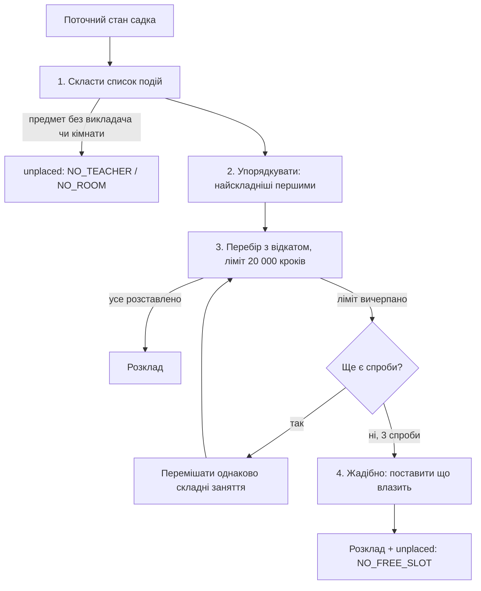
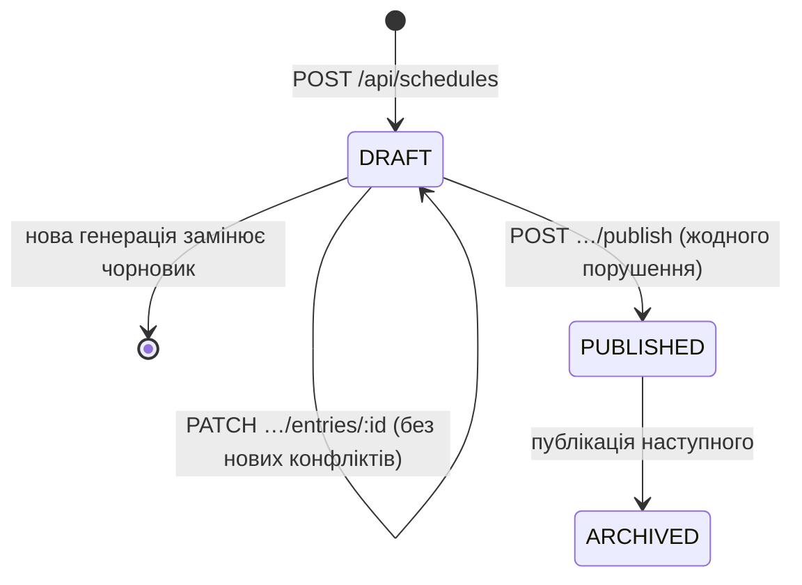

# Розклад: як він генерується і перевіряється

Документ пояснює, як система складає тижневий розклад для всіх груп (EPIC-05, FR-006–FR-008, FR-021): що саме вона розставляє, за якими правилами, яким алгоритмом і як перевіряє результат. Код:

- [schedule-generator.js](../../src/services/schedule-generator.js) — генератор, чиста функція;
- [schedule-rules.js](../../src/services/schedule-rules.js) — перевірка готового розкладу;
- [schedule-service.js](../../src/services/schedule-service.js) — чорновик, правки, публікація, перегляд.

## 1. Задача

Для кожної групи на тиждень треба розставити:

- щодня **сніданок, обід, полуденок** (по 30 хв) і **сон** (60 хв);
- **заняття** з кожного предмета — стільки разів на тиждень, скільки задано для віку групи; заняття з логопедом — лише групам, де є дитина, якій він потрібен.

Кожному заняттю треба вибрати **день, час, викладача й кімнату** так, щоб не порушити жодного жорсткого правила. Це класична задача шкільного розкладу (_school timetabling_): задача задоволення обмежень, NP-складна в загальному випадку. На практиці її розв'язують евристиками ([Schaerf, «A survey of automated timetabling»](https://ir.cwi.nl/pub/4935/4935D.pdf)); наш підхід — перебір з відкатом і розстановкою від найскладнішого, як у генераторі шкільних розкладів [FET](https://sources.debian.org/data/main/f/fet/7.0.8-3/doc/algorithm/algorithm-description.txt).

## 2. Сітка часу

| Що         | Значення                                                                                                          |
| ---------- | ----------------------------------------------------------------------------------------------------------------- |
| Дні        | понеділок–п'ятниця (BR-50: розклад щотижня той самий)                                                             |
| Години     | 09:00–17:00 (BR-42: 8 годин)                                                                                      |
| Слот       | 15 хвилин, 32 слоти на день: `0` — 09:00, `31` — 16:45                                                            |
| Прийом їжі | 2 слоти                                                                                                           |
| Сон        | 4 слоти                                                                                                           |
| Заняття    | `lessonMinutes / 15` слотів; за замовчуванням 30 хв, тобто 2 слоти (BR-59); дід змінює тривалість у налаштуваннях |

Слот у 15 хвилин дає змогу задати будь-яку тривалість заняття, кратну 15 хвилинам. Час зберігається номером слота, тож перевірка «чи зайнято» — це порівняння чисел.

## 3. Вхідні дані

Генератор отримує поточний стан садка (його збирає `ScheduleService`):

| Дані         | Що з них важливо                                                                                           |
| ------------ | ---------------------------------------------------------------------------------------------------------- |
| Групи        | вік; чи відвідує логопеда (є хоча б одна дитина з `needsSpeechLessons`, FR-021)                            |
| Предмети     | `lessonsPerWeekAge2` … `lessonsPerWeekAge5` (навантаження за віком, BR-54, BR-60); `speechLessons`         |
| Викладачі    | які предмети веде (`subjectIds`)                                                                           |
| Кімнати      | для яких предметів (`subjectIds`); кімната групи (`groupId`) для занять не використовується (BR-14, BR-15) |
| Налаштування | тривалість заняття                                                                                         |

## 4. Правила

### Жорсткі — розклад, що їх порушує, не публікується

| Правило                                                                                                              | Звідки                       |
| -------------------------------------------------------------------------------------------------------------------- | ---------------------------- |
| Група в кожен слот робить щось одне                                                                                  | BR-47                        |
| Викладач у кожен слот веде щонайбільше одну групу                                                                    | BR-46                        |
| Кімната в кожен слот приймає щонайбільше одну групу                                                                  | FR-009, BR-18                |
| Заняття веде викладач цього предмета, у кімнаті для цього предмета                                                   | BR-15, BR-18, 2.4            |
| Той самий предмет не стоїть у групи двічі підряд                                                                     | BR-61                        |
| Щодня рівно три прийоми їжі й один сон, кожен у своєму вікні                                                         | BR-43, BR-44, BR-52          |
| Прийоми їжі не стоять підряд                                                                                         | BR-45                        |
| Кожна група має кожен предмет стільки разів, скільки задано для її віку; логопед — лише для груп, що його потребують | BR-48, BR-54, FR-007, FR-021 |
| Подія не виходить за 17:00                                                                                           | BR-42                        |

**Вікна режиму дня** (коли може починатись подія):

| Подія     | Початок     | Тривалість |
| --------- | ----------- | ---------- |
| Сніданок  | 09:00       | 30 хв      |
| Обід      | 11:30–12:30 | 30 хв      |
| Сон       | 12:30–14:00 | 60 хв      |
| Полуденок | 15:00–16:00 | 30 хв      |

Вікна не перетинаються й не стикаються, тому прийоми їжі ніколи не стоять підряд — BR-45 виконується самою побудовою, але перевірка все одно його контролює. Групи можуть їсти й спати в різний час (BR-63).

### М'які — генератор прагне до них, але не вимагає

- Заняття одного предмета в групи — в різні дні.
- У групи один викладач на предмет.
- Групи їдять і сплять у різний час, а не всі одночасно.

Рівномірність навантаження викладачів не вимагається (BR-56, BR-57), тож генератор її не шукає.

## 5. Алгоритм



### Крок 1. Список подій

Для кожної групи:

- 5 днів × 4 події режиму дня = 20 подій;
- для кожного предмета — `lessonsPerWeekAge<вік групи>` подій-занять (заняття з логопедом — лише якщо група його відвідує). Кожне заняття знає список викладачів і список кімнат свого предмета.

Якщо предмет ніхто не веде або для нього немає кімнати, його заняття одразу йдуть у `unplaced` з причиною `NO_TEACHER` чи `NO_ROOM`: розставляти їх марно.

Для садка з вимог (15 груп, 6 предметів по 2 заняття, логопед у кількох групах) це близько 460 подій.

### Крок 2. Порядок: найскладніші першими

Головна евристика задач розкладу — **спершу ставити те, для чого найменше варіантів**. Поки сітка порожня, для «важкої» події ще знайдеться місце; якщо ж залишити її на кінець, усе вже може бути зайнято.

Порядок:

1. **Режим дня** — у нього найменше варіантів (сніданок узагалі один), і він визначає, які слоти дня лишаються для занять.
2. **Заняття** — за кількістю пар «викладач × кімната»: предмет з одним викладачем і однією кімнатою (як логопед) іде раніше за предмет, який можуть вести двоє в трьох кімнатах.
3. **Серед однаково складних занять** — спершу перше заняття кожного предмета в усіх групах, потім друге і так далі (поле `round`). Без цього заняття однієї групи стояли б поспіль, і останні групи отримували б лише ті слоти, що не взяли інші, — їхні заняття одного предмета змушено опинялись би в один день.

Порядок рахується один раз, на старті (статично, як у FET), а не наново після кожного кроку. Повний динамічний вибір «найобмеженішої» події на кожному кроці для ~460 подій означав би мільйони перевірок на крок; статичний порядок дає майже ту саму користь і працює миттєво.

### Крок 3. Перебір з відкатом

Генератор бере події по черзі й кожній пробує варіанти — від найкращого:

```
place(i):
    якщо i = кількість подій → готово
    для кожного варіанта події i (від найкращого):
        якщо кроків > ліміт → зупинитись
        зайняти слоти варіанта
        якщо place(i + 1) → готово
        звільнити слоти варіанта          ← відкат
    нічого не підійшло → повернутись до події i − 1
```

**Які варіанти бувають.**

- **Режим дня:** кожен початок у вікні, де група вільна. Перебір починається з точки, що залежить від номера групи (`номер % ширина вікна`), тому групи займають вікно по-різному й їдять та сплять у різний час (BR-63).
- **Заняття:** кожна комбінація «день × слот × викладач × кімната», де одночасно вільні група, викладач і кімната на весь час заняття, і де безпосередньо перед і після немає заняття того самого предмета (BR-61).

**Порядок варіантів заняття** (м'які правила):

1. Спершу дні, де цього предмета в групи ще немає, потім — де його найменше.
2. Серед них — дні, де в групи найменше занять загалом.
3. Слоти — від ранку.
4. Першим пробується викладач, який уже веде цей предмет у групі.

**Стан.** Для кожної групи, викладача й кімнати на кожен день зберігається масив із 32 позначок «зайнято». Зайняти чи звільнити подію — пройти її слоти; перевірити, чи вільно, — те саме. Окремо зберігається, який предмет стоїть у групи в кожному слоті (для BR-61), скільки занять кожного предмета й загалом у групи щодня (для порядку днів) і хто основний викладач предмета в групі.

**Варіанти генеруються ліниво**, по одному (функція-генератор JavaScript). Пошукові зазвичай вистачає першого-другого варіанта, тож повний список із тисяч комбінацій не будується.

### Ліміт, спроби й чесний звіт

Задача може не мати розв'язку взагалі — наприклад, якщо заняттям у спортзалі потрібно більше часу, ніж його є (див. розділ 8). Тоді перебір крутився б безкінечно, тому:

1. **Ліміт кроків:** 20 000 спроб поставити подію на одну спробу.
2. **До трьох спроб:** кожна наступна перемішує порядок однаково складних занять. Перемішування детерміноване (генератор псевдовипадкових чисел mulberry32 з фіксованим початковим значенням), тому **однакові дані завжди дають однаковий розклад**.
3. **Жадібна розстановка:** якщо жодна спроба не вдалась, генератор іде по подіях один раз без відкатів, ставить кожну на перше вільне місце, а ті, яким місця не знайшлось, записує в `unplaced` з причиною `NO_FREE_SLOT` і кількістю.

Такий чорновик зберігається, його можна переглянути й поправити, але **опублікувати не можна**: групи одного віку мали б різну кількість занять (FR-007).

### Приклад

Перша група садка з вимог (2 роки), понеділок, як його складає генератор:

```
09:00  Сніданок           ← режим дня: перша подія, вікно з одного варіанта
09:30  Боротьба — Спортзал
10:00  Музика   — Музичний зал
10:30  Логопед  — Кабінет логопеда   ← лише бо в групі є дитина, що його потребує
11:30  Обід                ← інша група почала б о 11:45 (BR-63)
12:30  Сон (до 13:30)
15:00  Полуденок
```

Решта занять тижня пішла на інші дні: на вівторок генератор першим пробує предмети, яких у групи ще не було.

## 6. Перевірка розкладу

Генератор дотримується правил, поки розставляє. Але розклад змінюється й після генерації: його правлять люди, а дані під ним змінюються (видалили викладача, змінили тривалість заняття). Тому є окрема функція `checkSchedule(події, стан садка)`, яка перевіряє **готовий** розклад, хто б його не склав, і повертає список порушень з людськими повідомленнями:

| Код                 | Що порушено                                                                     |
| ------------------- | ------------------------------------------------------------------------------- |
| `GROUP_BUSY`        | група в одну мить на двох подіях (BR-47)                                        |
| `TEACHER_BUSY`      | викладач з двома групами одночасно (BR-46)                                      |
| `ROOM_BUSY`         | дві групи в кімнаті одночасно (FR-009)                                          |
| `SUBJECT_IN_A_ROW`  | той самий предмет двічі підряд (BR-61)                                          |
| `ROUTINE`           | немає прийому їжі чи сну, він не в своєму вікні чи їх два (BR-43, BR-44, BR-52) |
| `MEALS_IN_A_ROW`    | два прийоми їжі підряд (BR-45)                                                  |
| `TEACHER_SUBJECT`   | викладач не веде цей предмет                                                    |
| `ROOM_SUBJECT`      | кімната не для цього предмета (BR-15)                                           |
| `LESSON_LENGTH`     | заняття довше чи коротше, ніж задано (BR-59)                                    |
| `LESSON_COUNT`      | у групи не стільки занять предмета, скільки задано для її віку (FR-007, FR-021) |
| `MISSING_REFERENCE` | групу, предмет, викладача чи кімнату видалили (BR-53)                           |
| `OUT_OF_DAY`        | подія закінчується після 17:00 (BR-42)                                          |

Приклад повідомлення: «Teacher Music teaches two groups at MON 09:30.»

Тести генератора перевіряють, що для його результату `checkSchedule` повертає порожній список. Тести перевірки беруть правильний розклад і ламають у ньому по одному правилу — щоб упевнитись, що кожне порушення справді помічається.

## 7. Життєвий цикл розкладу



- **Генерація** (`POST /api/schedules`, дід і менеджер) — новий чорновик з поточних даних; попередній чорновик видаляється. Одночасно є щонайбільше один чорновик і один опублікований розклад.
- **Правка** (`PATCH /api/schedules/:id/entries/:entryId`) — змінити день, слот, кімнату чи викладача події; лише в чорновику.
    - Чорновик може вже мати порушення (нерозставлені заняття, видалений викладач). Тому правку відхиляє лише **нове** порушення: `checkSchedule` запускається до правки й після, і порівнюються результати. Нове порушення — `409 SCHEDULE_CONFLICT` з поясненням у `details`; база не змінюється.
    - Викладач правує лише свої заняття (день, час, кімнату) і не може віддати заняття іншому (розділ 2.4 вимог).
- **Публікація** (`POST /api/schedules/:id/publish`) — повна перевірка проти поточних даних, без поблажок. Будь-яке порушення — `409 SCHEDULE_INVALID` з переліком. Попередній опублікований розклад стає архівним.
- **Розклад не перебудовується сам**, коли змінюються дані (BR-53): новий завжди генерують вручну.

## 8. Перегляд

Опублікований розклад, тиждень по днях, з часом і назвами:

| Запит                            | Хто бачить                                                       |
| -------------------------------- | ---------------------------------------------------------------- |
| `GET /api/groups/:id/schedule`   | дід, менеджер, вихователь своєї групи, батьки групи своєї дитини |
| `GET /api/teachers/:id/schedule` | дід, менеджер, сам викладач                                      |
| `GET /api/rooms/:id/schedule`    | дід, менеджер (доступність приміщення, FR-009)                   |

Групи, де викладач має заняття в опублікованому розкладі, стають «його»: він бачить їх і дітей у них — ім'я, прізвище, стать і вік (розділ 2.4).

## 9. Швидкодія й межі

**Швидкодія** (садок з вимог, 15 груп, ~460 подій):

| Що                                          | Час       |
| ------------------------------------------- | --------- |
| Генерація (лише алгоритм)                   | ~10 мс    |
| Генерація через API (зі збереженням у базу) | ~120 мс   |
| Правка події                                | ~70 мс    |
| Публікація                                  | ~30 мс    |
| Нерозв'язна задача (до вичерпання ліміту)   | 1,5–2,5 с |

**Вузьке місце — спортзал.** Фізкультура й боротьба ділять одну кімнату (BR-18, BR-19), а в ній $5 \times 32 = 160$ слотів на тиждень. Потреба для 15 груп:

$$
15 \text{ груп} \times (2 + 2) \text{ заняття} \times \text{слотів на заняття}
$$

- заняття по 30 хв (2 слоти): $15 \cdot 4 \cdot 2 = 120 \le 160$ — розклад вміщується;
- заняття по 60 хв (4 слоти): $15 \cdot 4 \cdot 4 = 240 > 160$ — розв'язку немає, генератор поверне `NO_FREE_SLOT`.

Отже, збільшувати тривалість чи кількість занять у спортзалі можна, лише поки ця нерівність виконується (або з другим спортзалом).

**Що алгоритм не гарантує:**

- **Оптимальності.** Він шукає розклад, що виконує всі жорсткі правила, а не «найкращий» за м'якими. Наприклад, заняття тяжіють до ранку, бо слоти перебираються від ранку.
- **Знаходження розв'язку, якщо той надто «тісний».** Евристика з лімітом може не знайти розв'язок, який існує. На реальних даних садка запас великий, і розклад знаходиться з першої спроби.

Якщо в майбутньому знадобиться оптимізувати м'які правила (рівномірність по тижню, «обід після занять» тощо), природний наступний крок — друга фаза покращення поверх знайденого розкладу (імітація відпалу або табу-пошук), як радять огляди задач розкладу.

## 10. Тести

- [schedule-generator.test.js](../../tests/services/schedule-generator.test.js) — 15 груп без порушень; режим дня; логопед; різні дні для предмета; навантаження за віком; заняття по 60 хв; кімната групи не для занять; детермінованість; причини `NO_TEACHER`, `NO_ROOM`, `NO_FREE_SLOT`.
- [schedule-rules.test.js](../../tests/services/schedule-rules.test.js) — кожне порушення окремо.
- [schedules.test.js](../../tests/http/schedules.test.js), [schedule-views.test.js](../../tests/http/schedule-views.test.js) — генерація, правки, публікація, перегляд і доступ через HTTP.
